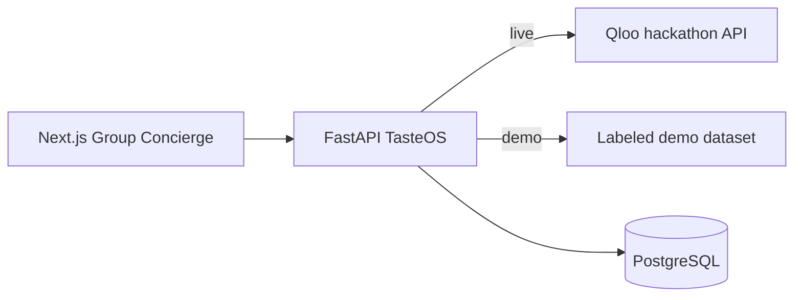

# TasteOS

**The Cultural Intelligence Layer for AI Agents.**

TasteOS is a reusable cultural-intelligence API backed by [Qloo](https://docs.qloo.com/) Taste AI. The flagship demo, **Group Concierge**, helps people with different tastes negotiate a shared outing — with inspectable evidence and trade-offs, not a black-box chatbot.

> Built for the [Qloo Agentic Hackathon](https://qloo.devpost.com/) · Submission deadline: **Oct 30, 2026 11:45pm EDT**

## Problem

Agents can plan steps, but they are culturally blind. Groups stall when tastes conflict. Generic LLM advice averages preferences into bland suggestions and cannot show *why* an option fits each person.

## Solution

TasteOS Core exposes profiles, search, recommendations, and provenance over HTTP. Group Concierge orchestrates a modular pipeline (resolve → retrieve → constrain → negotiate → compose → explain) so judges can see Qloo-retrieved evidence versus TasteOS application ranking (`tasteos_negotiation_v1`).

## Why Qloo is essential

Without Qloo, this would be keyword matching or LLM memory. In **live** mode TasteOS calls Qloo `GET /search` and `GET /v2/insights` (header `X-Api-Key`, host `hackathon.api.qloo.com`). Affinity is copied only when returned. **Demo** mode uses a clearly labeled sample dataset (`tasteos_demo_dataset`) so the UI always works offline from Qloo quota — never presented as live Qloo.

## Features

- Anonymous taste profiles (nickname only) + demo profiles + reset/delete
- Entity search and recommendations via verified Qloo client (live) or labeled demo data
- Group Concierge: shared plan, itinerary (proposed only), alternatives, reject/regenerate
- Transparent negotiation scores (`app_rank_score`) separate from `qloo_affinity`
- OpenAPI at `/docs`, CLI `check-qloo`, CORS allowlist, rate limits, redacted errors

## Architecture



Modules: Taste Profile Resolver → Cultural Candidate Retriever → Constraint Evaluator → Negotiation Engine → Plan Composer → Explanation Generator. Details: [docs/ARCHITECTURE.md](docs/ARCHITECTURE.md).

## Technology stack

| Layer | Stack |
| --- | --- |
| Frontend | Next.js App Router, TypeScript, Tailwind, shadcn/ui |
| Backend | Python 3.11+, FastAPI, Pydantic, SQLAlchemy, Alembic |
| Cultural AI | Qloo Search + Insights |
| Hosting | Netlify (Frontend) & GCP Compute Engine VM via Docker (Backend + DB) — see Deployment |

## Repository layout

```text
apps/web     Next.js UI
apps/api     FastAPI Core + Concierge
docs/        Architecture, API contracts, deployment, security
scripts/     Helpers (e.g. bundle secret scan)
```

## Local installation

**Prerequisites:** Node 20+, Python 3.11+, npm. Optional: Docker, Qloo hackathon API key.

### Windows PowerShell

```powershell
cd E:\Hackathons\devpost\Qloo
if (-not (Test-Path .env)) { Copy-Item .env.example .env }
python -m venv .venv
.\.venv\Scripts\Activate.ps1
pip install -U pip
pip install -e "apps/api[dev]"

# Terminal A — API
cd apps\api
uvicorn app.main:app --reload --host 0.0.0.0 --port 8000

# Terminal B — Web
cd ..\web
npm install
npm run dev
```

- Web: http://localhost:3000  
- API health: http://localhost:8000/health  
- OpenAPI: http://localhost:8000/docs  

### Environment setup

See [.env.example](.env.example). Never commit real `.env` files.

| Variable | Where | Notes |
| --- | --- | --- |
| `TASTEOS_MODE` | API | `demo` or `live` |
| `QLOO_API_KEY` | API only | Required for live; never `NEXT_PUBLIC_*` |
| `QLOO_BASE_URL` | API | `https://hackathon.api.qloo.com` |
| `DATABASE_URL` | API | PostgreSQL URL (`postgresql+psycopg://...`; `postgresql://` auto-normalized) |
| `FRONTEND_URL` | API | Exact web origin for CORS |
| `CORS_ORIGINS` | API | Optional comma-separated extra CORS origins |
| `NEXT_PUBLIC_API_BASE_URL` | Web | Public API base URL only |

### CLI

```bash
cd apps/api
python -m app.cli mode
python -m app.cli check-qloo   # live Search→Insights; never prints the key
```

Exit codes for `check-qloo`: `0` ok · `1` upstream/auth failure · `2` key not configured.

## API documentation

- OpenAPI UI: `{API}/docs`
- Contracts: [docs/API.md](docs/API.md)

Core routes include `/api/v1/profiles*`, `/api/v1/recommendations`, `/api/v1/concierge/plan`, reject/regenerate.

## Tests

```bash
# Backend unit (no live network)
cd apps/api && pytest -q --ignore=tests/test_qloo_integration.py

# Live Qloo integration (optional)
# TASTEOS_RUN_LIVE_QLOO=1 pytest -m integration -q tests/test_qloo_integration.py

# Frontend
cd apps/web && npm run lint && npm run typecheck && npm run build
npx playwright test   # needs API + web running
```

Latest local unit run: **66 passed** (`pytest --ignore=tests/test_qloo_integration.py`).

## Deployment

Detailed guide: [docs/DEPLOYMENT.md](docs/DEPLOYMENT.md).

| Role | Target | Config |
| --- | --- | --- |
| Frontend | Netlify | `netlify.toml` (Next.js App Router via `@netlify/plugin-nextjs`) |
| Backend & DB | GCP Compute Engine VM | `docker-compose.yml` (FastAPI + PostgreSQL 16) |

## Demo mode

Public Cloud Run API currently runs **demo mode**: candidates are labeled `tasteos_demo_dataset`. Live Qloo Search→Insights has been verified **locally** via `check-qloo` / integration tests when a key is present — enable live on Cloud Run only after wiring `QLOO_API_KEY` via Secret Manager (never in the browser).

## Security and privacy

- Secrets server-side; logging redacts credential patterns  
- CORS allowlist; rate limits; Pydantic validation; ~1 MB body cap  
- Anonymous nicknames only; profile delete supported  
- See [docs/SECURITY.md](docs/SECURITY.md)

## Known limitations

- Public Cloud Run API is **demo** unless you enable live secrets.  
- Group consensus is TasteOS-ranked — Qloo does not guarantee agreement.  
- Itineraries are **proposals**, not bookings.  
- PostgreSQL ensures durable persistence across container restarts.  
- Entity search picker in the UI is limited (text favorites); live Insights needs real Qloo entity UUIDs.  
- Public GitHub/GitLab URL and hosted frontend URL must be published by the entrant for full Devpost eligibility.

## License

[MIT](LICENSE) — open-source license file in the repository root.
