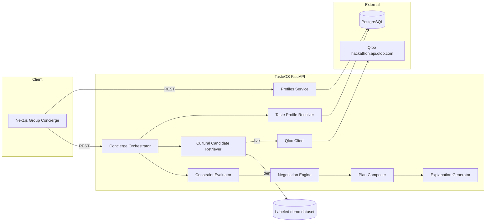

# Architecture — TasteOS



## Layers

1. **TasteOS Core** — reusable HTTP API for profiles, search, recommendations.
2. **Group Concierge** — flagship UX that orchestrates modular Python modules (not a swarm of LLMs).
3. **Qloo integration** — authenticated server-side client for `/search` and `/v2/insights` (never duplicated inside Concierge).

## Modes

- **Demo:** curated dataset, explicit labels, no silent fallback from live failures.
- **Live:** real Qloo requests; application ranking remains separate from Qloo affinity.

## Group Concierge pipeline

| Stage | Module | Responsibility |
| --- | --- | --- |
| 1 | `TasteProfileResolver` | Load demo or DB profiles; normalize favorites/exclusions |
| 2 | `CulturalCandidateRetriever` | **Live:** Qloo Search (resolve favorites → UUIDs) then Insights (taste + location). **Demo:** labeled `insights_demo` |
| 3 | `ConstraintEvaluator` | Hard exclusions, rejections, budget tag filters |
| 4 | `NegotiationEngine` | Deterministic `tasteos_negotiation_v1` ranking |
| 5 | `PlanComposer` | Proposed itinerary stops (`is_proposed=true`) |
| 6 | `ExplanationGenerator` | Tradeoffs + selection rationale; booking disclaimer |

Orchestrator: `app/services/concierge/service.py` → `POST /api/v1/concierge/plan`  
Reject/regenerate: `POST /api/v1/concierge/plan/{id}/reject?entity_id=` appends a hard exclusion and recomputes.

## Negotiation method — `tasteos_negotiation_v1`

**Source of truth:** `app/agents/negotiation.py`

### Per-participant statuses

| Status | Meaning | `app_score` |
| --- | --- | --- |
| `excluded` | Hard entity-id exclusion | `0` |
| `conflict` | Soft anti-preference (`avoid X` / `no X` vs tags) | `0.15` |
| `supported` | Tag/preference/explainability/demo heuristic evidence | deterministic in `(0, 1]` |
| `unknown` | No evidence | `null` (aggregates as neutral `0.5`) |

`qloo_affinity` is copied **only** in live mode when Qloo returns it. Demo mode always sets it `null`. Missing evidence is never fabricated.

### Group score

```
app_rank_score =
    0.45 * fairness          # 1 − (max−min) among non-excluded known scores
  + 0.35 * mean_support      # mean of per-participant contributions (unknown → 0.5)
  + 0.15 * coverage          # (#supported) / n
  + 0.05 * diversity_norm    # from candidate tag cardinality
  + qloo_component           # ≤ 0.15 * live affinity; 0 in demo
```

Clamped to `[0, 1]`. Sort by `−app_rank_score`, then name (deterministic).

**Fairness intent:** maximizing one person's affinity cannot dominate — coverage + fairness weights exceed the capped Qloo component.

### Evidence vs explanation

| Field | Kind |
| --- | --- |
| `participant_matches[].evidence`, `evidence_refs` | Retrieved / rule-matched signals |
| `qloo_affinity` | Retrieved from Qloo when present |
| `app_rank_score`, `ranking_inputs` | TasteOS application logic |
| `match_explanation`, `tradeoffs`, `selection_rationale` | Generated explanations |

### Limitations (always disclosed)

- Qloo does **not** guarantee group consensus.
- Itineraries are **proposals** — no reservations/availability/bookings.
- Demo candidates are labeled `tasteos_demo_dataset` (local/demo mode only — public Cloud Run is live).
- Favorites without valid Qloo entity UUIDs are omitted from live Insights signals (with a limitation note).
- Unknown evidence stays `unknown`.
- Without Qloo (no live key / no resolvable entities and no location), there are no taste-based recommendations.

## Persistence

SQLAlchemy models + Alembic (`taste_profiles`, `recommendations`). Concierge plans persist as `kind=concierge_plan` for reject/regenerate and GET-by-id.
